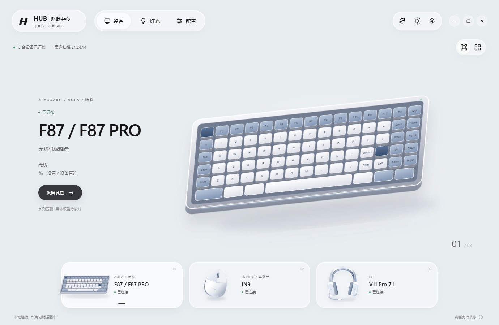
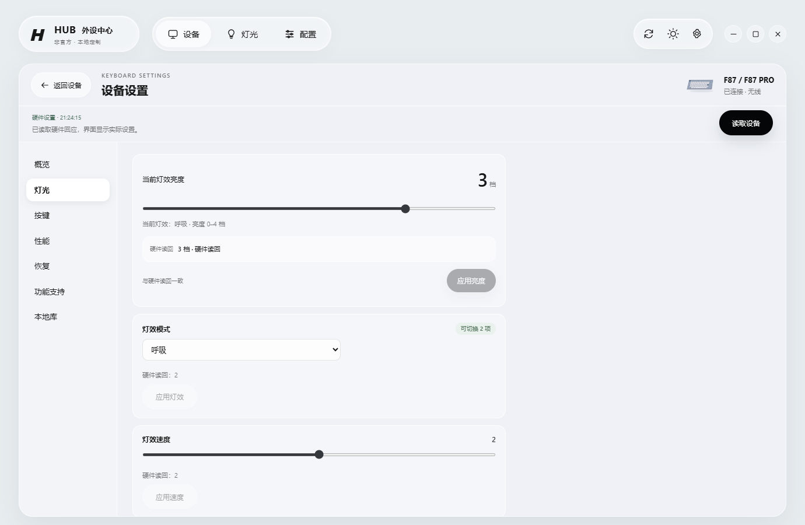
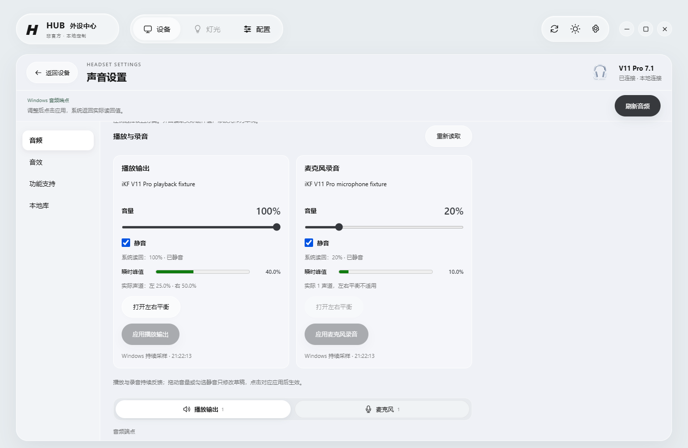

# Peripheral Hub 外设中心

非官方 Windows 外设管理工具。在同一个界面里管理 AULA F87 PRO 键盘、Inphic IN9 鼠标和 iKF V11 Pro（7.1）耳机，配置和恢复记录保存在本机。

[下载 Windows x64 安装包](https://github.com/Z-Fovik-RT/peripheral-hub/releases) · [使用说明](HUB-使用说明.md)



## 支持范围

| 设备 | 可用功能 | 注意事项 |
| --- | --- | --- |
| AULA F87 PRO | 灯效、亮度、速度、休眠和防抖；DCT 编辑与导出 | 四层按键与逐键 RGB 并非完整板载写入功能，供本地草稿与诊断使用 |
| Inphic IN9 | 电量、PSF 导入/预览/导出、DPI、回报率、灯光、普通按键分配 | 先导入自己的 PSF；传输回执不是设备完整读回，也不能恢复未知原配置 |
| iKF V11 Pro（7.1） | 播放/录音总览、音量、静音、EQ、环绕和应用关联 | 部分音效需要已安装的厂商音频驱动和 APO；本项目不安装驱动 |

下面是软件实际渲染界面，状态与数值为演示数据。





## 从源码构建

需要 **Windows x64、Git、PowerShell 7（默认安装路径）及 Node.js 22 或更新版本**。首次构建需联网下载并校验固定版本的 Electron 和 NSIS；不需要厂商安装包、Visual Studio 或本项目的旧工作区。

```powershell
git clone https://github.com/Z-Fovik-RT/peripheral-hub.git
cd peripheral-hub
pwsh -NoProfile -File .\Build-Installer.ps1
```

产物在 `dist/`，包含 `*-x64-Setup.exe` 和 `.sha256`。只想运行不打包，可执行 `pwsh -NoProfile -File .\Build-CustomHub.ps1` 后打开 `Start-Hub.cmd`。构建不会写入设备或安装驱动。

公开版不提供宏或固件升级，不打包原厂背景、语音、PSF 模板或私有驱动。厂商设备兼容性仍按型号、连接和驱动状态而定。第三方组件见 [THIRD-PARTY-NOTICES.md](THIRD-PARTY-NOTICES.md)。
